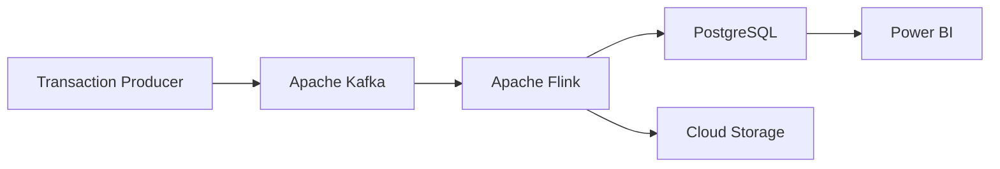

# Real-Time Retail Analytics Platform

A cloud-based platform for processing and analyzing real-time retail transaction data.

## Project Overview

This project builds a real-time data system for a retail chain. The system collects sales transactions continuously, processes streaming data, stores the results, and provides data for analysis and reporting.

Apache Kafka is used to receive transaction streams, Apache Flink processes and aggregates the data, and PostgreSQL stores the processed results.

### Vietnamese Project Title

**Xây dựng Hệ thống Dữ liệu Trực tuyến cho Cửa hàng Bán lẻ với Kafka, Flink và PostgreSQL**

### English Project Title

**Building a Real-Time Retail Data System with Kafka, Flink, and PostgreSQL**

## Main Objectives

- Generate and collect retail transaction data continuously.
- Process transaction streams in real time.
- Calculate total revenue and product sales.
- Analyze revenue by product and store.
- Store processed results in PostgreSQL.
- Support data analysis and reporting.
- Deploy and evaluate the system in a cloud environment.

## System Architecture



## Technologies

- Python
- Apache Kafka
- Apache Flink
- PostgreSQL
- Microsoft Azure
- Power BI

## Kafka Producer local — Giai đoạn 04

Sau khi Kafka trong `docker/compose.yaml` healthy, dùng Python 3.12 trong `.venv` và cài `pip install -r producer/requirements.txt`. Mặc định CLI kết nối `localhost:9094`, topic `retail.sales.transactions`; `.env` cục bộ có thể đặt `KAFKA_BOOTSTRAP_SERVERS` và `KAFKA_TOPIC`, CLI ghi đè hai giá trị này. Không commit `.env` hoặc kết quả chạy trong `reports/runtime/`.

Trước **mỗi** run, lưu high offsets của 3 partitions. Sau khi Producer kết thúc, Consumer probe chỉ đọc từ baseline đó và lọc `run_id`; không nhầm message của lần thử cũ. Ví dụ:

```bash
.venv/bin/python producer/consumer_probe.py --capture-baseline reports/runtime/demo.baseline.json
.venv/bin/python producer/live.py --rate 5 --limit 20 --seed 2026 --run-id demo_live_01 --stats-output reports/runtime/demo.producer.json
.venv/bin/python producer/consumer_probe.py --baseline-file reports/runtime/demo.baseline.json --run-id demo_live_01 --expected 20 --producer-stats reports/runtime/demo.producer.json --output reports/runtime/demo.result.json
```

Replay 1.000 dòng (sau khi tạo **baseline mới**) bằng:

```bash
.venv/bin/python producer/replay.py --input data/samples/synthetic_10000.jsonl --limit 1000 --run-id demo_replay_01 --stats-output reports/runtime/replay.producer.json
```

Khi probe replay, thêm `--source-input data/samples/synthetic_10000.jsonl` (hoặc file dunnhumby chuyển đổi local) để so **từng bản ghi** với dữ liệu nguồn, trừ `run_id` và `emitted_at` được phép đổi. `--expected` quyết định số dòng đầu tiên cần so và giới hạn bộ nhớ của phép đối soát này.

`--rate 0` trong replay gửi nhanh nhất có thể; live bắt buộc `--limit` hoặc `--duration` và `--rate > 0`. Mỗi lần chạy dùng `run_id` mới. Replay giữ nguyên `transaction_id`, `event_time`, `basket_id`, `price`, `line_revenue` và `currency`; chỉ đổi `run_id` và điền `emitted_at` UTC. Khóa nhận diện khi đối soát nhiều run là `(run_id, transaction_id)`. Không suy ra số hóa đơn từ `basket_id` dunnhumby bị mất chính xác.

Message key là `store_id`, nên các dòng của cùng cửa hàng vào cùng partition và giữ thứ tự trong partition. Phân bố tải có thể lệch nếu cửa hàng có nhiều giao dịch; số partition thực tế xuất hiện trong file probe. Producer dùng `acks=all` và idempotence của client, nhưng không bảo đảm exactly-once cho cả pipeline hoặc giữa các lần replay. `delivered` chỉ tăng khi callback nhận ACK; `pending` phải bằng 0. `payload_bytes` là tổng byte UTF-8 **được ACK**. Throughput là `delivered / elapsed_seconds` của bước gửi và flush, không bao gồm preflight JSONL. Callback latency đo từ lúc ứng dụng gọi `produce()` đến khi callback được chạy, gồm thời gian ở client queue và `poll/flush`; không phải độ trễ riêng của broker. Đây là số đo local demo, chưa phải benchmark cloud.

## Course Information

- **Course:** Cloud Computing
- **Course Code:** IS402
- **University:** University of Information Technology – VNU-HCM
- **Instructor:** ThS. Hà Lê Hoài Trung
- **Email:** [trunghlh@uit.edu.vn](mailto:trunghlh@uit.edu.vn)

## Team Members

| No. | Full Name | Student ID | Email |
|---:|---|---:|---|
| 1 | Nguyễn Trần Thảo Nguyên | 23521052 | [23521052@gm.uit.edu.vn](mailto:23521052@gm.uit.edu.vn) |
| 2 | Nguyễn Thuý Ngân | 23520996 | [23520996@gm.uit.edu.vn](mailto:23520996@gm.uit.edu.vn) |
| 3 | Lê Đào Anh Thư | 23521537 | [23521537@gm.uit.edu.vn](mailto:23521537@gm.uit.edu.vn) |
