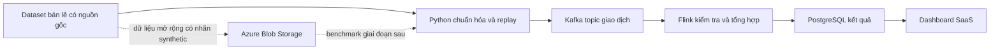

# Kiến trúc dự kiến cho hệ thống bán lẻ trực tuyến

**Trạng thái:** bản thiết kế Giai đoạn 01, chưa có pipeline chạy. Nguồn yêu cầu: đề bài đồ án, kế hoạch v2.0 và tab `Bài tập Lớn` của rubric.

## Mục tiêu nghiệp vụ và bốn nhóm bài toán

Chuỗi cửa hàng cần nhìn thấy doanh thu, số lượng bán, sản phẩm và cửa hàng theo thời gian khi giao dịch mới xuất hiện. Hệ thống phải cho phép kiểm tra kết quả xử lý từ dữ liệu đầu vào, đồng thời giới hạn thông tin theo quyền người xem.

| Nhóm | Câu hỏi cần trả lời | Thành phần dự kiến |
|---|---|---|
| Thu thập | Giao dịch được đưa vào luồng liên tục thế nào? | Dataset, Python Producer, Kafka |
| Xử lý | Bản ghi sai/trùng được xử lý ra sao và doanh thu được tính thế nào? | Flink streaming ETL |
| Lưu trữ | Kết quả tổng hợp được lưu, truy vấn và đối soát ở đâu? | PostgreSQL; Blob cho dữ liệu benchmark và manifest |
| Trực quan | Người dùng xem doanh thu theo vai trò và thiết bị thế nào? | Dashboard SaaS, ưu tiên Power BI nếu POC đạt |

## Dòng dữ liệu và môi trường

- **LOCAL, GĐ 01–07:** Mac dùng dữ liệu nhỏ; về sau Kafka một broker KRaft, Flink JobManager/TaskManager và PostgreSQL local. Hiện GĐ01 chỉ kiểm tra môi trường và thiết kế.
- **CLOUD, từ GĐ08:** Azure VM dự kiến chạy Producer/Kafka/Flink; Azure Database for PostgreSQL Flexible Server lưu kết quả; Azure Blob Storage giữ các chunk và manifest benchmark. VM thứ hai ở region khác chỉ phục vụ phép đo GĐ11 nếu quota và ngân sách cho phép.
- **SAAS, GĐ09:** Bốn report riêng theo mặc định, dùng chung nguồn dữ liệu cloud, có điều hướng, phép thử cập nhật, phân quyền và bố cục mobile. Power BI Service chỉ được chốt sau POC; bốn trang trong một report cần giảng viên xác nhận.

Python phát lại giao dịch theo nhịp có kiểm soát. Kafka nhận sự kiện và giữ log tạm thời. Flink đọc Kafka, lọc và biến đổi bản ghi, tính tổng hợp theo thời gian/sản phẩm/cửa hàng. PostgreSQL lưu bảng kết quả để truy vấn. Dashboard đọc kết quả từ PostgreSQL qua kết nối được phép. Blob phục vụ dữ liệu nguồn benchmark, không thay PostgreSQL làm nơi chứa kết quả BI.

**ETL:** Extract từ Kafka; Transform bằng kiểm tra trường bắt buộc, số lượng/giá, xử lý trùng, watermark/window và tổng hợp; Load kết quả vào PostgreSQL. Đây là thiết kế, chưa có kiểm thử tính đúng hay bảo đảm exactly-once.

## Dữ liệu và schema sơ bộ

Đề bài yêu cầu `transaction_id`, `product_id`, `quantity`, `price`, `timestamp`, `customer_id`. Dự kiến bổ sung `store_id`, `category_id`, `run_id`, `emitted_at`, `source_type`, `currency`. Một message biểu diễn **một dòng sản phẩm của một hóa đơn**; `transaction_id` duy nhất cho từng dòng. `price` dùng số nguyên VND hoặc DECIMAL, tránh float khi tính tiền. `timestamp` lịch sử và `emitted_at` khi replay phải phân biệt, thời gian pipeline dùng UTC. Đây là hợp đồng sơ bộ; data dictionary và schema chính thức thuộc GĐ02.

Nhóm ưu tiên dataset bán lẻ có nguồn và giấy phép sử dụng rõ, sẽ chọn và ghi provenance ở GĐ02. Dữ liệu synthetic có thể mở rộng quy mô để benchmark, phải gắn `source_type=synthetic` và công bố quy tắc sinh. Không coi dữ liệu synthetic là giao dịch thật, không tải bộ dữ liệu 40 GB về Mac. Mốc >4 GB và số bản ghi Flink xử lý chỉ được công nhận bằng manifest/byte/log đối soát thật ở GĐ10.

## Phép đo dự kiến

| Phép đo | Nguồn minh chứng dự kiến | Giai đoạn |
|---|---|---|
| Số bản ghi gửi/nhận/xử lý, valid/invalid/duplicate, doanh thu đối soát | Producer ACK, Kafka offset, Flink metrics, SQL | 04–07, 10 |
| Throughput và độ trễ event → DB → dashboard, p50/p95 | Log timestamp của cùng `run_id`, ba lần đo | 09–11 |
| Dung lượng raw/payload, RAM/CPU/disk khi xử lý | Manifest bytes, metrics hệ thống và container | 10–11 |
| Độ trễ hai region, cùng workload | VM/DB region, RTT, query timing | 11 |
| Tác động tối ưu storage → ứng dụng | Baseline và A/B Blob → reader hoặc DB → dashboard | 11 |
| Quota, chi phí và phân quyền cloud | Azure Portal/Cost Management/IAM | 01, 08, 12 |

Không điền số đo dự đoán vào kết quả. Cần ghi cấu hình, thời điểm, đơn vị và log gốc của mỗi phép thử.

## Phân loại dịch vụ cloud

| Dịch vụ dự kiến | Loại | Lý do |
|---|---|---|
| Azure VM | IaaS | Nhóm quản trị hệ điều hành và ứng dụng trên máy ảo. |
| Azure Blob Storage | PaaS | Dịch vụ lưu object do Azure quản lý. |
| Azure Database for PostgreSQL Flexible Server | PaaS | Azure quản trị nền tảng cơ sở dữ liệu. |
| Power BI Service, nếu POC đạt | SaaS | Dịch vụ báo cáo người dùng truy cập qua web. |
| FaaS | Không sử dụng | Nhánh trực quan của rubric không yêu cầu function. |

Việc liệt kê dịch vụ chưa chứng minh chúng đã được triển khai. Trạng thái thực tế được cập nhật trong hồ sơ Azure/dashboard và ma trận rubric.
