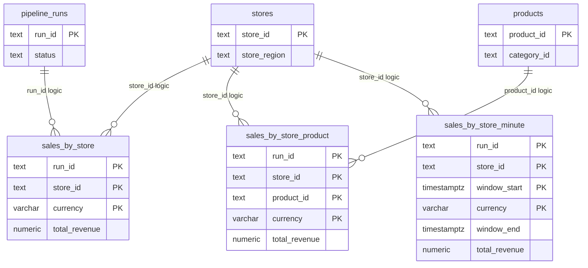

# Giai đoạn 06 — PostgreSQL và Flink JDBC

## Mô hình và khóa

Mỗi Kafka message là một dòng sản phẩm. Flink dùng `deduplicated_lines` của Giai đoạn 05, loại trùng theo `(run_id, transaction_id)`, rồi ghi **giá trị tổng hợp hiện tại** bằng JDBC UPSERT. Doanh thu luôn là `SUM(line_revenue)` kiểu DECIMAL/NUMERIC; `currency` nằm trong mọi khóa tổng hợp. PostgreSQL không tự cộng doanh thu vào giá trị cũ.



Các đường nối là quan hệ logic; **không có foreign key** vì sink có thể đến trước bước seed. Chỉ seed ID, `store_region`, `category_id` đã quan sát; không bịa tên hay địa chỉ. `window_start/end` là thời điểm UTC trong PostgreSQL `TIMESTAMPTZ`; phiên SQL Client đặt `table.local-time-zone=UTC` trước khi chuyển Flink `TIMESTAMP_LTZ` sang `TIMESTAMP(3)` mà JDBC connector hỗ trợ. Nguồn dunnhumby vẫn có `event_time_basis=assumed_timezone` và `currency=XXX`; không diễn giải nó thành timezone/currency đã được nhà cung cấp xác nhận.

`pipeline_runs` lưu metadata theo run để vận hành/đối soát; trạng thái `VALIDATED` chỉ được ghi sau khi so nguồn độc lập với cả ba bảng. Producer ACK và job `FINISHED` riêng lẻ không đủ để đặt trạng thái này. Lượt có window mở hoặc late event chưa được đối soát giữ `PENDING`.

## Chạy lại phép thử local

Yêu cầu Docker stack hiện có hoạt động và PostgreSQL local có schema. Không chạy `down -v`.

```sh
docker exec -i retail-local-postgres-1 sh -c 'psql -X -U "$POSTGRES_USER" -d "$POSTGRES_DB" -v ON_ERROR_STOP=1' < sql/postgres/01_schema.sql
docker exec -i retail-local-postgres-1 sh -c 'psql -X -U "$POSTGRES_USER" -d "$POSTGRES_DB" -v ON_ERROR_STOP=1' < sql/postgres/03_indexes.sql
.venv/bin/python sql/postgres/seed_dimensions.py --input data/samples/synthetic_10000.jsonl --limit 1000
.venv/bin/python producer/consumer_probe.py --capture-baseline reports/runtime/flink/my_start.json
.venv/bin/python producer/replay.py --input data/samples/synthetic_10000.jsonl --limit 1000 --run-id my_unique_run
.venv/bin/python producer/consumer_probe.py --capture-baseline reports/runtime/flink/my_end.json
.venv/bin/python sql/flink/run_jdbc.py --name my_unique_job --start reports/runtime/flink/my_start.json --end reports/runtime/flink/my_end.json
.venv/bin/python sql/postgres/reconcile.py --input data/samples/synthetic_10000.jsonl --limit 1000 --run-id my_unique_run --replayed
```

`run_jdbc.py` đọc thông tin đăng nhập từ container PostgreSQL hiện có, tạo SQL tạm với quyền `0600`, xóa sau submit và chỉ ghi log đã che mật khẩu trong `reports/runtime/` (Git ignore). Các offset start/end là **high offsets** Kafka, tách chính xác lần thử khỏi dữ liệu cũ; mọi aggregate tiếp tục nhóm theo `run_id`. Với job chạy liên tục, bỏ `--end`; dừng an toàn bằng `flink stop --savepointPath file:///opt/flink/checkpoints/savepoints <job-id>` trong JobManager. Không dùng `sql/flink/run_sql.py` để ghi JDBC: script đó phục vụ truy vấn Giai đoạn 05.

DDL `CREATE TABLE IF NOT EXISTS` và index/seed chạy lại không xóa dữ liệu. Nếu một bảng cũ đã tồn tại với cấu trúc khác, PostgreSQL sẽ không tự migrate; phải kiểm tra và viết migration riêng trước khi dùng.

## Kết quả thực nghiệm 2026-11-17

| Run | Đầu vào / chính sách | `sales_by_store` | `sales_by_store_product` | `sales_by_store_minute` | Count, quantity, revenue |
|---|---|---:|---:|---:|---|
| `stage06_syn_1000` | 1.000 synthetic, bounded offsets | 5 | 373 | 334 | 1.000 / 2.985 / 310.265,83 USD, khớp cả 3 bảng |
| `stage06_quality_a` + `_b` | 10 raw; 5 invalid, 1 duplicate, 4 accepted | 3 hàng theo 2 run | 4 hàng | 3 hàng | 4 / 8 / 9,50 USD, khớp |
| `stage06_sor_100` | 100 dunnhumby transformed, bounded | 7 | 99 | 18 | 100 / 145 / 223,95 XXX, khớp |
| `stage06_ordered_01` | 21 live, một event chỉ để tiến watermark | 1 | 20 | 20 cửa sổ đã đóng | 21 / 65 / 6.147,57 USD ở bảng không window; 20 / 64 / 5.982,53 USD ở 20 window đã đóng, khớp |

Đối soát từng khóa có trong [06-reconciliation.csv](evidence/06-reconciliation.csv). Lượt synthetic được chạy lại **đúng offset**; số row và tổng không đổi, xác nhận UPSERT không nhân đôi trong phép thử này. Live `stage06_live_01` tăng từ 0 → 10 → 20 → 25 giao dịch ở bảng store; 10 ID cũ phát lại sau restore không được cộng thêm. Job `8fdbe310b2ba8153f2117be9919bbebe` có checkpoint thành công ID 5, tạo savepoint `savepoint-8fdbe3-0311e909c774`; job phục hồi `a77f683d3c0c8af65855950b91030737` báo `restored=1` và thêm 5 ID mới đúng. Đây là bằng chứng local về recovery và UPSERT, **không chứng minh exactly-once xuyên ba JDBC sinks**.

DDL/index/seed đã chạy lại thành công trên database có dữ liệu; PK aggregate chủ động từ chối một INSERT trùng trong PL/pgSQL block tự rollback. `unittest discover` đạt **21/21** (GĐ02–06); `docker compose config --quiet` hợp lệ. Sau thử nghiệm không còn Flink job `RUNNING`.

Lượt `stage06_live_01` cố tình đưa event lịch sử cũ vào sau khi watermark đã tiến. Bảng store/product nhận 25 dòng, còn bảng phút chỉ nhận 12 dòng trong các window đã đóng; late event không được window nhận lại. Vì vậy metadata run này giữ `PENDING`, không dùng làm bằng chứng đối soát toàn bộ bảng phút. Với job live, chỉ đối soát các cửa sổ mà watermark đã đóng; `stage06_ordered_01` kiểm chứng trường hợp event time tăng và marker đóng 20 cửa sổ. Cần thiết kế đường xử lý late event/đối soát riêng nếu dùng các luồng trễ tùy ý trong vận hành lâu dài.

Các `EXPLAIN (ANALYZE, BUFFERS)` và kiểu/khóa PostgreSQL thực có trong [06-index-explain.txt](evidence/06-index-explain.txt). Bảng local nhỏ nên PostgreSQL chọn Sequential Scan (5 hàng store, 334 hàng minute), execution time tương ứng khoảng 0,026 ms và 0,131 ms trong lần đo; **không suy ra index cải thiện tốc độ**. Hai index phụ chỉ phục vụ lọc product theo run và minute range khi dữ liệu tăng, còn PK đã tạo index cho các khóa UPSERT.

JDBC connector `4.1.0-2.2` cần thêm `openlineage-java` và `openlineage-sql-java` `1.32.0` theo [POM core](https://repo.maven.apache.org/maven2/org/apache/flink/flink-connector-jdbc-core/4.1.0-2.2/flink-connector-jdbc-core-4.1.0-2.2.pom) và [POM parent](https://repo.maven.apache.org/maven2/org/apache/flink/flink-connector-jdbc-parent/4.1.0-2.2/flink-connector-jdbc-parent-4.1.0-2.2.pom); Dockerfile đã thêm URL và SHA-256. Connector cũng không ghi trực tiếp `TIMESTAMP_LTZ(3)`, nên sink dùng `TIMESTAMP(3)` với session UTC. Hai lỗi này đã được tái hiện và sửa trước khi chạy đối soát. Chứng cứ thời điểm/Job ID nằm trong Flink REST và runtime log Git ignored; ảnh Flink UI/SQL có thể chụp từ dữ liệu thật khi làm báo cáo.
